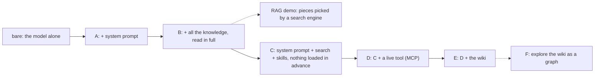

# Youth AI Lab - Customising a chatbot

### Erasmus+ project Youth AI Lab - hands-on workshop for partners and mentors

- **Project:** Youth AI Lab (Erasmus+), with five partners:
  - L.A.B. (Aix-en-Provence, France)
  - UAB (Barcelona, Spain)
  - Perlatecnica (Naples, Italy)
  - Digitale Wolven (Antwerp, Belgium)
  - CSC Vent des Îles (La Rochelle, France)
- **Facilitator:** Sébastien
- **Need help?**
  - Raise your hand and ask Sébastien.
  - If something breaks, don't panic: your files stay in the Codespace.

## Workshop - Customising a chatbot: from a bare model to a wildfire-prevention expert

> 🎯 **A 2-hour workshop, in pairs.** The goal is to **see what happens
> behind a chatbot**: what it reads before it answers, and who decides what it reads. You can
> use what you learn today if you run the **WikiYouthBot** activity with young people.

> 🎓 **Open your Codespace** (one per pair): 👉 **https://codespaces.new/Youth-AI-Lab/yal-workshop-kit**
>
> This link creates your own copy of the workshop kit, in an online editor based on VS Code. Everything runs in your browser: nothing to
> install. The detailed steps are in [Setup](#setup).

> 📚 **Sébastien's slides** use the same words as this page. You can follow the session
> here, at your own pace, and come back to it after the session to explore further.

### Contents

- [Goals of the session](#goals-of-the-session)
- [Setup](#setup)
- [The tools of the day](#the-tools-of-the-day)
- [Overview: one chatbot, built piece by piece](#overview-one-chatbot-built-piece-by-piece)
- [Opening - The test set (★, 15 min)](#opening---the-test-set--15-min)
- [Block A - Give it a personality (★, 15 min)](#block-a---give-it-a-personality--15-min)
- [Block B - Give it everything you know (★, 12 min)](#block-b---give-it-everything-you-know--12-min)
- [Demo - Vector RAG (5 min, by the facilitator)](#demo---vector-rag-5-min-by-the-facilitator)
- [Block C - Let it search, and curate what it knows (★★★, 25 min)](#block-c---let-it-search-and-curate-what-it-knows--25-min)
- [Block D - Connect it to live data (★★, 13 min)](#block-d---connect-it-to-live-data--13-min)
- [Block E - Organise what it knows: the wiki (★★★, 13 min) - Capstone](#block-e---organise-what-it-knows-the-wiki--13-min---capstone)
- [Block F - Explore the knowledge graph (★★, 10 min)](#block-f---explore-the-knowledge-graph--10-min)
- [Closing - Compare, and take it home (12 min)](#closing---compare-and-take-it-home-12-min)
- [Going further](#going-further)
- [Troubleshooting](#troubleshooting)

---

## Goals of the session

### What you will be able to do by the end of this session

You have **already chatted with a chatbot** such as ChatGPT, Gemini or Claude. You type
a question, and an answer comes back. But you cannot see **what the chatbot read** before it
answered. Was it a document? A web page? Nothing at all, only its memory? Soon, you may
customise a chatbot with young people (as we did in the **WikiYouthBot** activity). There, a Claude Project
or a Gemini Gem gives you only **two boxes**: *Instructions* and *Knowledge*. This workshop
shows you what happens behind these two boxes, one step at a time.

This progression follows **Bloom's taxonomy**, a teaching model that describes levels of mastery
of a skill - from the simplest (understanding a concept) to the most complex (creating something
new).

| Bloom level | Blocks | You will be able to... | Modes |
|---|---|---|---|
| **Understand** | Opening, A | **explain** what a **context window** is, and why a **system prompt** changes how a chatbot behaves, but not what it knows | `bare`, `A` |
| **Apply** | B, C (search) | give the chatbot **all its knowledge at once**, then let it **search** the files itself, and **compare** the two with the gauge and the cost | `B`, `C` |
| **Analyse** | RAG demo, C (curation), D | **check a summary** written by the model against the original document, sentence by sentence; **tell apart** what a document can say and what only a **live tool** can say | `C`, `D` |
| **Create** | E, F, Closing | **grow a wiki** with a new source and find its contradictions; **explore** it as a graph and **check** a connection the model guessed; **plan your own chatbot** (Instructions and Knowledge) for your territory | `E`, `wiki-explore` |

**All session long**, you also practise **testing a chatbot**: the same 11 questions, asked again
after each block, and scored in the same way. This is the most useful habit you can take home: it measures how well each change to a chatbot works.

### Why this approach?

All the blocks of the day answer **the same question**:

> **What enters the model's context, when, and who decides?**

The **model** is the program that writes the answers (here: Claude, made by Anthropic). The
**context** is everything the model reads before it answers: your question, its instructions,
and any document it was given. The model knows nothing else about your situation. Each block
adds something to the context, in a different way.

- **Why the same 11 questions after every block?** Without a fixed test, you only have
  **impressions**. A chatbot can sound better and be wrong more often. With the same questions
  and the same scoring, the columns of your score table can be **compared**. This is also the
  idea of the "Press Conference" in WikiYouthBot.
- **Why is "I don't know" worth more than a wrong answer?** An invented answer looks **exactly as
  confident** as a true one. About fire, a wrong rule can be dangerous. So an invented answer
  gets **0**, and an honest "I don't know" gets **1** (or **2** when the answer exists nowhere), and a good answer gets **2**.
- **Why Claude Code in a terminal, and not a chat website?** On a chat website, you see the
  boxes, but not what happens behind them. Here, you **see everything**: how full the context
  is, every file the model opens, every search, every tool it calls. The mechanisms are the
  same as in the tools you will use with young people.
- **Why one theme for the whole session?** With one running example, the steps can be compared. Our
  theme is **wildfire prevention**, with real official documents from the EU, France,
  Catalonia, Flanders and Italy. Our running example is **Feurisson**, a chatbot that young people in La Rochelle made this
  summer to help prevent wildfires.
- **Why the same model for everyone?** Comparing two versions of a chatbot only makes sense with
  the **same base model**. The model is set for all pairs when you save your key.

**The chatbot is what you study today.** It can be wrong, and sound sure of
itself. Each time, look at **what it read**, and compare with the source. A good question to
ask it after an answer: `Which document did you use for this answer?`. Then open that document
and check. In the first blocks, the facilitator will help you read what you see. In the last
blocks, try to explain it yourselves, in your pair.

### How this connects to WikiYouthBot

With young people (12 to 18 years old), you can customise a chatbot in a Claude Project or a
Gemini Gem. Each block of today matches a part of that work:

- **Block A** (system prompt) is the **Instructions** box: always read, in full.
- **Blocks B and C** (documents and summaries) are the **Knowledge** box. When it is small, it
  is read in full (block B). When it is big, it is searched for pieces.
- **Your test questions** are the **Press Conference**: the same questions before and after
  each change.
- **Blocks D and E** go one step further: live data, and knowledge that stays organised.

The full table is in the [Closing](#back-to-wikiyouthbot). If you remember only one thing:
you cannot see from the outside how a box is used. **That is why the test questions matter.**

### Before you start

#### What you need to know

- **No programming**: you will type about ten commands in a terminal. They are all written on this page:
  copy and paste them.
- **A little English**: the chatbot, the commands and this page are in English. Some official
  documents are in French, Italian, Catalan or Dutch. You don't need to read them all: dates and
  numbers are easy to compare in any language.
- **No expertise on wildfires**: the documents are here. You will learn as you go.
- **Your pair**: you work two by two, on one screen. Change who types at each block: this way, you both learn how the tools work, and you can go on alone when you are back home.

#### Your environment

You work in a **GitHub Codespace**: a text editor (VS Code) running in your browser, on a
computer of GitHub. Everything is already installed. You need **one free GitHub account per
pair**. The facilitator sends each pair an **API key** on WhatsApp: a long password that
lets your Codespace use Anthropic's model. Each key has a spending limit and only works for a short time.

The chatbot runs in **Claude Code**, a program that lets a model work in a folder of files.
Developers use it to write code. We use it because it **shows everything**: what the model
reads, searches and does.

> ℹ️ **Note.** **This is intentional.** Claude Code is not the tool you will use with young people. It is a
> glass box: the same mechanisms as in a Claude Project or a Gemini Gem, but you can see inside. At the end of the workshop, Sébastien will show you how to build your own chatbot from what you made today.

### Reference documents

All of these are in your Codespace, in the file list on the left:

- `test-questions.md`: the 11 test questions, their expected answers and the scoring rules.
- `scores.md`: your score sheet, one short line per question.
- `AGENTS.md`: the system prompt of your chatbot (block A).
- `examples/AGENTS.feurisson.md`: a filled-in example, inspired by Feurisson.
- `corpus/index.md` and `summaries/index.md`: the list of the official documents and of their
  summaries.
- `inbox/README.md`: the document you will add in block C.
- `mcp/fire-danger.json`: the live data of block D.

In the terminal you can try: `workshop help`, `corpus-add --help`, `wiki-start --help`, `wiki-graph --help`.

---

## Setup

Do these steps **once**, at the start of the session. They take about 5 minutes.

### Step 1 - Open your Codespace

1. **Sign in to GitHub** with the account of one of you (a free account is enough).
2. **Open the link** of the workshop:

   👉 **https://codespaces.new/Youth-AI-Lab/yal-workshop-kit**

3. **Click** the button **"Create codespace"**.
4. **Wait about 2 minutes** while the Codespace is built.

You should see VS Code in your browser: the **list of files** on the left (`AGENTS.md`,
`README.md`, `corpus`, `summaries`…), and a **terminal** at the bottom of the screen. The
terminal is where you type commands. If you don't see it, open the menu (☰) at the top left,
then **"Terminal"**, then **"New Terminal"**.

> ⚠️ **Important.** **Your Codespace is personal and it keeps your work.** Use the same one all session long: do
> **not** create a new one each time. If it stops after a long pause, reopen it from
> **https://github.com/codespaces**: nothing is lost.

### Step 2 - Let the Codespace wait for you

By default, a Codespace stops after **30 minutes** without activity. You lose nothing, but it
takes about 30 seconds to restart. To avoid this:

1. **Open** https://github.com/settings/codespaces in a new browser tab.
2. **Find** the setting **"Default idle timeout"**.
3. **Set it** to **120** minutes or more (the maximum is 240), and save.

### Step 3 - Save the key of your pair

1. **Copy the key** from the facilitator's WhatsApp message. Open WhatsApp **on this
   computer** (WhatsApp Web, `web.whatsapp.com`, or the desktop app), so that you can paste the
   key in the Codespace. Copy the **whole** key: one long word that starts with `sk-ant-`.
2. **Click in the terminal**, at the bottom of the screen.
3. **Type** this command, then press **Enter**:

   ```bash
   workshop-login
   ```

4. **Paste the key** when the terminal asks for it:

   ```
   Paste the API key of your pair, then press Enter:
   ```

   > 💡 The key itself is **not shown**: you see one `*` per character instead. This is
   > normal: it is a password. The first time, the browser may ask for permission to paste:
   > accept, then check that the `*` appeared. **Paste only once.**

5. **Press Enter.** The key is tested at once, with a very small request to the model.

You should see (with the start and the last 4 characters of your key):

```
Key received: sk-ant-…a1b2 (… characters). Testing it…
Key OK (Anthropic, model claude-sonnet-5-5). You can start: workshop bare
```

If you see another message, look at [Troubleshooting](#troubleshooting).

### Step 4 - Your first conversation

1. **Type**:

   ```bash
   workshop bare
   ```

   You should see this line, then the screen of Claude Code:

   ```
   Workshop — mode bare. To quit: press Ctrl+C twice. Other modes: workshop bare | A | B | C | D | E
   ```

2. **The first time**, a few screens come one after the other. None of them is a problem:
   - your **browser** may ask whether the page can use the fonts installed on your computer:
     click **Allow** (or Block: both work);
   - Claude Code asks you to **choose a text style** (theme): keep the one proposed and press
     **Enter**;
   - it asks whether you **trust the folder**: accept;
   - it reminds you that **Claude can make mistakes**: press **Enter**;
   - it says **"Welcome to Claude Code for VS Code"**: press **Enter** to continue.

   It asks once more to trust a folder the first time you start mode A (the kit folder):
   accept again.
3. **Look above the input box**: a line like `Clear 0% of context 0 / 200k` shows how full the
   **context window** is (200k = 200,000 tokens). This is **the gauge**. Keep an eye on it all
   session long: it tells the story of the day.
4. **Type a first message**, for example `Hello, who are you?`, and press Enter. Read the answer.
5. **Leave** the conversation: press **Ctrl+C twice**. You are back in the terminal.

Commands that start with `/` are typed **inside** a conversation; they work from mode C on (in
modes bare, A and B they are switched off on purpose, and `/exit` says "Unknown command"). All
other commands are typed in the terminal, **outside** a conversation.

### Step 5 - Open a second terminal

Some commands take time. A second terminal lets you go on working in the first one.

1. **Click the `+`** at the top right of the terminal panel.
2. A new terminal opens. You can switch between the two in the list on the right of the panel.

> 💡 **Tip.** **One terminal to chat, one terminal to test.** Use the first one for `workshop`, the second
> one for `replay`.

If you got the message `Key OK` and had a first conversation, **everything is ready**.

---

## The tools of the day

### 📋 Memo - The commands

| Command | Where to type it | What it does |
|---|---|---|
| `workshop-login` | terminal | saves the key of your pair and tests it (once) |
| `workshop <mode>` | terminal | starts a conversation with the chatbot in one **mode**: `bare`, `A`, `B`, `C`, `D` or `E` |
| `replay <mode>` | terminal | asks all your test questions in this mode, one new conversation per question, and writes the answers in `answers/` |
| `replay <mode> 8 11` | terminal | the same, only for questions 8 and 11 |
| `workshop help` | terminal | what each mode puts in the context |
| `corpus-add …` | terminal | adds an official document to `corpus/` (block C) |
| `wiki-start` | terminal | unpacks the wiki (block E) |
| `wiki-graph` | terminal | draws the map of the wiki in `wiki/graph.md` (block E) |
| `wiki-explore` | terminal | opens the knowledge graph of the wiki in your browser (`wiki-explore stop` closes it); `wiki-explore help` for more (block F) |
| `chatbot-export` | terminal | packs your chatbot (instructions + knowledge) into one `.zip` file (Closing) |
| `Ctrl+Shift+V` | in an open `.md` file | shows it as a readable page: titles, tables, lists (`Cmd+Shift+V` on a Mac) |
| `Ctrl+C` twice | in a conversation | leaves the conversation (all modes) |
| `/context` | in a conversation | shows in detail what fills the context window (modes C, D, E) |
| `/mcp` | in a conversation | shows the live-data tool and its state (modes D and E) |
| `/status` | in a conversation | shows the gateway and the key in use (modes C, D, E) |

The **mode** letters are not case-sensitive: `workshop a` works as well as `workshop A`.


> 💡 **Tip.** **To read a Markdown file** (a file whose name ends in `.md`), open it, then press
> `Ctrl+Shift+V` (`Cmd+Shift+V` on a Mac), or right-click on it in the file list and choose
> **"Open Preview"**: titles, tables and lists become a readable page. **To write in a file**
> (`AGENTS.md`, `scores.md`…), stay in the normal editor, where you can type.

### 📋 Memo - The words of the day

Each word is explained again the first time a block uses it.

| Word | What it means here |
|---|---|
| **Model** | The program that writes the answers. Here: Claude Sonnet, the same for every pair. |
| **Context** (or **context window**) | Everything the model reads before it answers. It has a maximum size: here, 200,000 tokens. |
| **Token** | The unit used to measure text for a model: a piece of a word. On average, 4 characters of English text. |
| **System prompt** | Instructions the model reads at the start of every conversation: who it is, its rules. |
| **Corpus** | The collection of official documents the chatbot can use. |
| **Summary** | A short text in English about one document, written by the model and checked by a person. |
| **Skill** | A written procedure that the model follows when it needs it. |
| **MCP** | *Model Context Protocol*: a standard way to give a tool to a model (here, a tool that reads live data). |
| **RAG** | *Retrieval-Augmented Generation*: a search engine picks pieces of documents, and only these pieces go to the model. |
| **Wiki** | Pages organised by topic, linked together, each fact with a note that gives its source. |

### What the chatbot can know

| Folder | What it holds | Who writes it |
|---|---|---|
| `corpus/` | **20 official documents** (web pages, PDF, Word), exactly as they were retrieved, never modified. A readable copy of each one is in `corpus/text/`. Start with `corpus/index.md`. | The authorities |
| `summaries/` | **One short summary in English per document.** Start with `summaries/index.md`: it says which ones a person has checked ("human-reviewed"). | The model; then a person checks it |
| `inbox/` | A document that is **not in the corpus yet**. You add it in block C. | - |
| `wiki/` | Appears in block E: pages by topic, each fact with a footnote to its source. | The model |

Every file of `corpus/text/`, `summaries/` and `wiki/` starts with a small **header** in the
**Open Knowledge Format (OKF)**: its type, its source, who wrote it, and who verified it. In a
summary, an entry of the `verified` list that starts with `by: human:` means that **a person**
checked it against the source. `status: draft` means that **no person** has checked it yet
(programs may have checked some of it).

### The work loop for each block

From the Opening to block E, you will repeat **the same work loop**. Each block only changes
step 2.

1. **Read** the context of the block: what problem did the previous step leave?
2. **Add** one thing to the chatbot (a system prompt, knowledge, a tool...).
3. **Chat** with it: `workshop <mode>`. Watch the gauge, and read what the model does.
4. **Replay** the test questions in the second terminal: `replay <mode>`.
5. **Score** each answer from 0 to 2, in the column of the mode, in `scores.md`.
6. **Compare** with the previous column, in your pair: what improved, what did not, at what cost?

### How to score

The rules are also at the top of `test-questions.md`.

| Score | When |
|---|---|
| **2** | Right, **and** it says where it comes from. For questions 7 ("unknown") and 9 ("out of scope"), the right answer is to say so. |
| **1** | Honest but not enough: it says it cannot know although the answer exists (in the documents or through a tool), or it is right without its source, or only partly right. |
| **0** | Wrong or invented. **An invented answer is worse than "I don't know".** |

So "I don't know" gets **2** when the answer exists nowhere (question 7), and **1** when it
exists somewhere the chatbot cannot reach yet (in a document or through a tool).

> ⚠️ **Important.** **If an answer says "Warning: the model looked at the test material", score it 0.** The model
> opened `test-questions.md`, `answers/` or `examples/`: it may have copied the expected answer.
> An answer marked **ERROR** is not scored at all.

> 💡 **Tip.** **The reflex of the whole workshop**: after each answer, ask yourselves **"What entered the
> context, when, and who decided?"**. Look at the gauge, then at what the model read. The answer
> to this question explains almost every score of the day.

---

## Overview: one chatbot, built piece by piece

Each block answers the question of the day in a different way:

| Step | What you add | When it enters the context | Who decides | Mode |
|---|---|---|---|---|
| Start | Nothing: the model alone | - | - | `bare` |
| A | A system prompt (`AGENTS.md`): who it is, its rules | Always, at startup | You | `A` |
| B | Knowledge: all the summaries and documents | Always, in full | You | `B` |
| (demo) | Vector RAG: excerpts found by similarity | Per question | A search engine | - |
| C | Search in the files, and skills to curate the knowledge | Per question, what it finds | The model, step by step | `C` |
| D | A tool that reads live data (MCP) | Per question, if needed | The model, through a tool | `D` |
| E | A wiki, organised by topic, with a map | Per question, pages already written | The model, beforehand | `E` |
| F | A knowledge graph of the wiki, to explore | Not in the context: you read the map | You, then you check | `wiki-explore` |
| (slide) | A local model; fine-tuning | - | - | - |



Each mode keeps what the previous one had, **except B**: from C on, nothing is loaded in
advance. The model knows **where** the knowledge is, and goes to fetch what it needs. To see
what a mode sets up, type `workshop help`.

The session is planned for 2 hours: Opening 15 min, A 15 min, B 12 min, RAG demo 5 min, C 25 min,
D 13 min, E 13 min, F 10 min, Closing 12 min. 

Sébastien keeps time and tells you when to move on, so that we finish in time for lunch.

---

## Opening - The test set (★, 15 min)

### 📖 Before changing a chatbot, measure it

**Goal**: ask your 11 test questions to the model alone, and score its answers. This is your
**starting point**: every later column will be compared with this one.

A model alone has read a lot of text during its training, long ago. It has **no document** of
yours, and it does not know today's date or today's fire danger. Yet it will often answer
anyway. Your first job is to see **how often it is right, how often it says "I don't know", and
how often it invents**.

**What is provided**:

- `test-questions.md`: **11 questions, ready to use**, each with its category, its expected
  answer and its source, and the scoring rules.
- `scores.md`: your **score sheet**, one short line per question and six empty columns (`Bare`,
  `A`, `B`, `C`, `D`, `E`).
- `replay`: the command that asks each question in a **new conversation**, so that nothing
  carries over from one question to the next.

### What to do

This first block is fully guided. Follow each step.

#### Step 1 - Read the test set

1. **Open** `test-questions.md`: click on its name in the file list on the left, then press
   `Ctrl+Shift+V` to read it as a page (to change a question, close the preview and edit the file).
2. **Read** the scoring rules at the top, then the 11 questions. Notice the **categories**: some
   questions are precise, some ask for an explanation, one is about something nobody knows
   (7), one about today's level (8), two are traps (9 and 10), and one is about a document you
   will add later (11).

#### Step 2 - Replace questions (optional, now or never)

If you want, replace some questions with your own, for example a question about your
territory or a topic that matters to you. For each question you replace:

1. **Keep the same category**, so that the test stays balanced.
2. **Write the expected answer, with its source** (the document where you found it).
3. **Keep the table format**: one line per question, cells separated by `|`, the number in the
   first cell. `replay` reads this table.
4. **Save** the file (`Ctrl+S`, or `Cmd+S` on a Mac).

> ⚠️ **Important.** **Change the questions only BEFORE `replay bare`. Never afterwards.** If a question changes in
> the middle of the session, its scores can no longer be compared.

#### Step 3 - Replay the questions with the model alone

1. **Go to your second terminal** (see [Setup, step 5](#step-5---open-a-second-terminal)).
2. **Type**:

   ```bash
   replay bare
   ```

   Each question is asked to the bare chatbot, in a new conversation. You should see one line
   per question, then the name of the answer file and the total cost:

   ```
   Question 1 (1/11)…
   Question 2 (2/11)…
   …
   Question 11 (11/11)…
   Answers: answers/bare-14h05.md   (cost: $…, time: … min … s)
   ```

   The time in the file name and the cost will be different for you. In mode bare, it takes
   **about 2 minutes** and costs about $0.10.

3. **While it runs**, open the folder `answers/` in the file list: the file is written as the
   answers arrive. You can start reading at once (`Ctrl+Shift+V` to read it as a page).

#### Step 4 - Talk to the model alone, while the replay runs

1. **Go back to your first terminal** and start the bare chatbot:

   ```bash
   workshop bare
   ```

2. **Ask** question 1 of the test set:

   ```
   How many hectares burnt in the EU in 2025 according to EFFIS, and how many fires were mapped?
   ```

3. **Then ask**: `Where does this figure come from? Give me your source.` Does it give a
   document, a link, or nothing? Does it say when its knowledge stops?
4. **Look at the gauge**: a few thousand tokens only. The model alone has nothing to read: it
   answers from what it learnt during its training.
5. **Leave**: press **Ctrl+C twice**.

#### Step 5 - Read the answer file

The file starts like this:

```
# Answers — mode bare — 2026-10-22 14:05

Score each answer from 0 to 2 in the Bare column of scores.md.

## 1. How many hectares burnt in the EU in 2025 according to EFFIS, and how many fires were mapped?
```

Under each question, you find the **answer** of the chatbot, then a line such as
`*Context: … tokens*`: the size of the context for this answer. In later modes, a line
`*What the model did:*` also lists the files it read, the searches it ran and the tools it
called. In mode `bare`, it can do none of this.

#### Step 6 - Score column Bare

1. **Compare** each answer with the expected answer in `test-questions.md`.
2. **Decide** 0, 1 or 2 with the [scoring rules](#how-to-score). Discuss it in your pair: you
   must agree.
3. **Open** `scores.md` and **type the score** in the **Bare** column. Each row is short: the
   number, a few words on the question, then the columns Bare, A, B, C, D, E. For example, row 1
   becomes:

   ```
   |  1 | EU 2025: hectares and fires       |  1   |      |      |      |      |      |
   ```

   Click in the empty space under **Bare** and type the number: the columns stay readable even
   if the line moves by one character.

4. **Add up** your scores in the row **Total /22**, and **save** the file (`Ctrl+S`).

> 💡 **Tip.** **Look for invented details.** The model alone may give a precise figure, a name of an
> organisation or a website, with great confidence. If it is not in the expected answer, check
> before you give a point. An invented answer gets 0.

### Think about it

The model alone answered some questions without any document. **Where did these answers come
from, and why can't it give a source?** Discuss it in your pair. (Hint: when was the model
trained, and what was in its training?)

You will do the same after each block. **The questions don't change: otherwise nothing is
comparable.**

---

## Block A - Give it a personality (★, 15 min)

### 📖 A system prompt changes how it behaves, not what it knows

**Context**: in the Opening, the model alone did not know who it was talking to, nor what it
was for. It may have invented answers. In this block, you give it **instructions**.

A **system prompt** is a text that the model reads **at the start of every conversation**,
before your first message. It says who the chatbot is, what it is for, and which rules it must
follow. Here, the system prompt is the file `AGENTS.md`. You decide what is in it, **once**,
and it is always read **in full**.

The sections of `AGENTS.md` are **the same as in the WikiYouthBot minimal prompt**: Identity,
Theme, Rules, Quality requirements, Target personas, Reference Q&A, Bans and constraints. What
you write here is exactly what young people will write in the *Instructions* box.

**Goal**: write the system prompt of your chatbot, then measure what it changes.

**What you will discover**:

- **The cost of a system prompt**: it is read at every message, so it takes a place in the
  context window, all the time.
- **What instructions can do**: change the tone, make the chatbot refuse, make it say "I don't
  know".
- **What instructions cannot do**: give knowledge that the model does not have.

**What is provided**:

- `AGENTS.md`: **to complete**. Its seven sections are empty. Each one has a hint between
  `<!--` and `-->`. These hints are comments: **they are not sent to the model**.
- `examples/AGENTS.feurisson.md`: a **complete example**, inspired by Feurisson. It is **not
  read by the chatbot**: only `AGENTS.md` is.
- `CLAUDE.md`: *do not modify*. Claude Code only reads this file, and its only line,
  `@AGENTS.md`, imports your system prompt.

### What to do

1. **Open** `AGENTS.md`, then **open the example next to it**: right-click on
   `examples/AGENTS.feurisson.md` in the file list, then **"Open to the Side"**. In the example,
   press `Ctrl+Shift+V` to read it as a page. Keep `AGENTS.md` in the normal editor: you write in it.
2. **Read the example** section by section. Notice the **Rules**: say "I don't know", never
   invent, point out contradictions, never guess today's level.
3. **Write your own** system prompt in `AGENTS.md`, under each section title. You can take what
   you like from the example, but make it yours: your territory, your audience, your tone.
   Write full sentences, under the titles: **keep the titles as they are**.

   > ⚠️ Don't skip **Rules** and **Quality requirements**: the next blocks are scored on them.
   > For example: what should it answer when it does not know? What should it do when two
   > sources disagree? Should it say where each fact comes from?

4. **Save** the file (`Ctrl+S`).
5. **Start a conversation** in mode A:

   ```bash
   workshop A
   ```

   The gauge shows `0 / 200k`: it counts what was **sent** with the last message, and nothing has
   been sent yet. **Say hello** (type `Hello` and press Enter), then read the gauge, and compare
   it with the same `Hello` in mode `bare` (a few thousand tokens). The difference is the cost of
   your system prompt, paid again at every message.

6. **Test the behaviour**. Ask a few questions, for example:
   - `Who are you?`
   - `What is the best insurance company for my house?` (question 9)
   - `How many hectares burnt in Campania in 2025?` (question 7)

   Does it follow your rules? Does it refuse, or reframe? Does it say "I don't know"?
7. **Leave**: press **Ctrl+C twice**. If a rule is not followed, change `AGENTS.md`, save, and try again.
8. **Replay** the test questions in your second terminal, then **score column A**:

   ```bash
   replay A
   ```

**What to watch**: the **behaviour** changes (tone, refusals, "I don't know"). The
**knowledge** doesn't. The precise questions (1 to 4) do not improve, or the model makes things
up, sometimes with great confidence.

> ℹ️ **Note.** If you ask it which tools it has, it may list a shell or tools to read and write files. In modes
> bare, A and B it has **none**: the general instructions of Claude Code mention them, and the
> model repeats them. Another reason to check what a model says about itself.

> 💡 **Tip.** **Checkpoint before moving on**: `AGENTS.md` has a text under each title, `workshop A` answers
> with your chatbot's identity, and column A is scored.

### Think about it

Even with a perfect system prompt, **why don't the precise questions (1 to 4) improve?**
Discuss it in your pair. (Hint: what is in `AGENTS.md`, and what is not?)

> **You built** a system prompt. **Reused in** the *Instructions* box of a Claude Project or a
> Gemini Gem, and in the "system prompt" field of any chatbot tool.

---

## Block B - Give it everything you know (★, 12 min)

### 📖 Reading everything is simple, but every message pays for everything

**Context**: in block A, the chatbot learnt how to behave, but it still knows nothing about
the documents. The simplest idea is to **give it all the documents**, at the start of each
conversation.

In mode B, **all the summaries and all the readable copies of the documents** are added to the
system prompt. The model reads them before your first question, and again at every message.
This is like the *Knowledge* box of a Claude Project or a Gemini Gem, when it is small enough to
be read in full.

A context window has a maximum size, counted in **tokens**. A token is a piece of a word: on
average, 4 characters of English text (more in French, Italian, Catalan or Dutch). Here the
window holds 200,000 tokens. Our documents and summaries take about 100,000 tokens: **half of
the window**, sent again with every message, even the shortest one.

**Goal**: give the chatbot all the knowledge, and see what it gains and what it costs.

**What is provided**:

- `summaries/`: 17 summaries in English. **4 have been checked by a person** ("human-reviewed"
  in the index). The others are drafts, checked only by machines ("machine-confirmed").
- `corpus/`: the 20 official documents, and their readable copies in `corpus/text/`.
- Nothing to write in this block: mode B loads everything for you.

### What to do

1. **Have a look** at `summaries/index.md` and `corpus/index.md` (open them, then `Ctrl+Shift+V`). This is everything we know.
   Notice the label at the end of each summary line: "(human-reviewed)" or "(machine-confirmed)".
2. **Start a conversation** in mode B:

   ```bash
   workshop B
   ```

   The gauge shows `0 / 200k`: it counts what was **sent** with the last message, and nothing
   has been sent yet.
3. **Say hello** (type `Hello` and press Enter), then **read the gauge**: about
   **100k / 200k**, half the window, for a simple hello. Write it down: you will compare it with
   mode C.

4. **Try the contradiction experiment.** `summaries/10-…` and `summaries/90-…` summarise two
   official pages of the European Commission, published the same day. **They disagree.** Ask:

   ```
   How many hectares burnt outside the EU in 2025?
   ```

   Does the model **point out the contradiction**, or **choose silently**? Real sources
   contradict each other too. Leave: press Ctrl+C twice.
5. **Replay** the questions in your second terminal, then **score column B**:

   ```bash
   replay B
   ```

6. **Compare the cost** that `replay` prints at the end with the cost of `replay A`. Every
   single message pays for everything that is in the context.

**What to watch**: the precise questions are now answered. But we only have about twenty
documents. **With ten times more, they would not fit in the window at all.**

> 💡 **Tip.** **Checkpoint before moving on**: you saw the gauge at about half the window after a simple hello, you
> tried question 10, and column B is scored.

### Think about it

A youth centre has 200 documents about its town. **Why can't it use mode B?** And even with 20
documents, **why is mode B expensive?** (Hint: look at the gauge, and at what happens at each
new message.)

> **You built** a knowledge base of sourced documents. **Reused in** the *Knowledge* box of a
> Claude Project or a Gemini Gem: when it is small, it is read in full, like here.

---

## Demo - Vector RAG (5 min, by the facilitator)

### 📖 A search engine picks the pieces, and the model sees only those

**Context**: block B does not scale. When the knowledge is too big, most chatbot tools use a
**RAG** (*Retrieval-Augmented Generation*). The facilitator shows one, in another tool, on a
laptop. You only watch and discuss.

> Same documents as block B, cut into 322 small pieces. For each question, a search engine picks
> the 5 pieces that look most like the question. The model sees those 5 pieces, nothing else.

Two new words:

- **Chunk**: a small piece of a document (here, about 1,000 characters).
- **Embedding**: a list of numbers that captures the meaning of a chunk. Two chunks with
  close meanings have close lists of numbers. This is how the search engine finds the chunks
  that "look like" the question.

**What to watch**, for questions 3, 7 and 10:

- **Question 3**: the answer is in one precise sentence of a long order. Is the right piece
  among the 5?
- **Question 7**: nobody knows the answer. Does the search engine return nothing? **A RAG always
  returns something**, even when the answer is nowhere.
- **Question 10**: the two sources disagree. Do both enter the context, or only one?

Compare **what the model saw** (the excerpts) with **what it claims**.

This is what most chatbot tools do when the knowledge is too big to be read in full: fast and
cheap, but the model only sees what the search engine picked.

---

## Block C - Let it search, and curate what it knows (★★★, 25 min)

### 📖 Searching is cheaper than reading everything, and its failures are visible

**Context**: mode B reads everything, and pays for everything. The RAG demo reads only a few
pieces, but **a search engine** chooses them, and it always returns something. In mode C,
**nothing is loaded in advance**. The model knows where the knowledge is (two folders, each with
an index), and **it searches by itself**, step by step, like a person would.

It uses simple file tools: list a folder (`ls`), **search for a word** in files (`grep`), read
a file. When a search finds nothing, the model **sees zero results**. That failure is visible,
and the model can say "I don't know".

**Goal**: watch the model search, then **let a new document in** and vouch for its summary
yourselves.

**What you will discover**:

- **Agentic search**: the model decides what to open, one step after another. You can read
  each step in the conversation.
- **Skills**: written procedures that the model follows when it needs them.
- **Curation**: a person decides what enters the knowledge, and signs what the chatbot says
  about it.

**What is provided**:

- `.claude/skills/`: three skills, **complete**.
  - `summarize`: writes a draft summary of a document of `corpus/`, and a verification table.
  - `validate-summary`: records that a person checked a summary.
  - `source-note`: writes a summary from information you give it.
- `inbox/benevento-campagna-aib-2026.pdf`: a document in Italian, **not in the corpus yet**.
  Question 11 is about it.
- `corpus-add`: the command that adds a document to `corpus/`.

> ℹ️ **Note.** **Claude Code asks for your permission** before it writes or changes a file. In this block,
> the skills write files: read what it wants to do (green lines are added, red lines are
> removed), then accept with **1. Yes**. Never choose option 2 ("don't ask again" or "switch to
> accept edits"): you would no longer see what it writes. Searching and reading do not need your
> permission.

### Part 1 - Watch the model search

1. **Start a conversation** in mode C:

   ```bash
   workshop C
   ```

   Look at the gauge: it is far below mode B. Nothing is loaded in advance.
2. **Ask question 3** of the test set (copy it from `test-questions.md`):

   ```
   In Bouches-du-Rhône, at which fire-risk levels is access to forest massifs forbidden, and at the 'severe' level, when is work allowed?
   ```

   Its answer is **not in the summaries**: it is only in the full text of an order.
3. **Read the steps** in the conversation. Above the answer, a grey line sums them up, for
   example `Read 4 files, ran 1 shell command`: **click on it** to see the details. You should
   see the model search with `grep`, read an index and a summary, then open the full order in
   `corpus/text/` (`43-…`). It reads only what seems useful. **The gauge stays low**: about 30k,
   against 100k in mode B. The exact steps may vary from one try to the next.
4. **Ask a question whose answer is nowhere**, for example question 7:

   ```
   How many hectares burnt in Campania in 2025?
   ```

   Watch the searches: they find documents about Campania, but **none of them gives a figure
   for 2025**. The model can see that the answer is not there, and say "I don't know". A RAG
   would still hand it the closest pieces, as if they were the answer.

### Part 2 - Skills: what they are

A **skill** is a folder with a file `SKILL.md`: a procedure the model follows when it needs it.
Only its **description** (at the top of the file) is always in the context. The rest is read
only when the skill is used. So a chatbot can have many skills without filling its context.

1. **Open** `.claude/skills/summarize/SKILL.md`, then press `Ctrl+Shift+V`.
2. **Read the header** between the two `---` lines: `name` and `description`. The description
   says **when** the model should use the skill.
3. **Read the steps and the rules**. Notice: "Never add a `verified` entry yourself, and never
   mark a summary as checked." Only a person can do that.

### Part 3 - Let a new document in, and vouch for it

Question 11 is about a document the chatbot does not have yet: the plan of the **Province of
Benevento** (Campania, Italy) for the 2026 fire season. You let it in, and you vouch for it.
This is the work young people do in the *Data Box* of WikiYouthBot.

#### Step 1 - Add the document to the corpus

1. **Open** `inbox/README.md` (`Ctrl+Shift+V` to read it as a page) and **copy** its `corpus-add`
   command. It is one single line.
2. **Paste it** in the terminal (outside a conversation) and press **Enter**.

You should see:

```
Added: corpus/80-benevento-aib-2026.pdf (original, unchanged)
       corpus/text/80-benevento-aib-2026.md (readable copy, about 1,346 tokens)
Next, in "workshop C": summarize corpus/80-benevento-aib-2026.pdf
```

The document gets a number: **80**, or the next free one between 80 and 89. In the next steps,
use **your** number. Three things happened: the original is kept **unchanged** in `corpus/`, a
readable copy goes to `corpus/text/`, and a line is added to `corpus/index.md`.

#### Step 2 - Let the model write a draft summary

1. **In** `workshop C`, **ask**:

   ```
   summarize corpus/80-benevento-aib-2026.pdf
   ```

2. **Accept** when Claude Code asks for permission to write files. The `summarize` skill writes
   two files and adds a line to `summaries/index.md`:
   - `summaries/80-benevento-aib-2026.md`: the **draft summary**, 5 to 15 short sentences in
     English, one fact per sentence. Its header says `status: draft`, with no `verified` line.
   - `summaries/checks/80-benevento-aib-2026.md`: the **verification table**, with one row per
     sentence:

     ```
     | # | Sentence of the summary | Original passage (copied word for word) | OK? | Correction |
     ```

     The original passage is copied exactly, in Italian, so that you can find it with `Ctrl+F`.

#### Step 3 - Check each sentence yourselves

1. **Open** the table `summaries/checks/80-benevento-aib-2026.md`.
2. **Open the original document next to it**: right-click on `corpus/80-benevento-aib-2026.pdf`,
   then **"Open to the Side"**. The PDF viewer opens.
3. **For each row**: copy a few words of the original passage, search them in the PDF with
   `Ctrl+F`, and compare. Do this **even in Italian**: dates and numbers are easy to compare.

   > 💡 If `Ctrl+F` does not find a passage in the PDF (a line break can cut it), search it in
   > the readable copy, `corpus/text/80-benevento-aib-2026.md`.

4. **Fill the "OK?" column**: `yes` if the sentence says what the passage says, or write the
   right version in the "Correction" column.
5. **Save** the table.

> ⚠️ **Important.** **Every row must be checked.** A general "it's fine" is not enough: the skill will list the
> rows that are not checked, and ask you to check them. Resist the temptation to trust the draft
> because it looks right. **You** sign it, not the model.

#### Step 4 - Validate the summary

1. **Tell the chatbot** that you checked it, with your name:

   ```
   I checked summary 80, I am <first name last name>
   ```

   or, if a sentence is wrong:

   ```
   sentence 3 is wrong, it should be …
   ```

2. The `validate-summary` skill applies **only your corrections**, then **shows you the
   corrected sentences and asks you to confirm them**. Read them, and confirm.
3. **Accept** the file changes. The skill then adds your name to the header, in a line
   `verified`, as `human:<first-name-last-name>` (for example `human:maria-rossi`), and sets
   `status: stable`.

#### Step 5 - Check the result

1. **Open** `summaries/index.md` (`Ctrl+Shift+V`). At the bottom, under "Added during the session", your summary
   went from **"(draft, not verified)"** to **"(human-reviewed)"**.
2. **Leave** the conversation: press **Ctrl+C twice**.
3. **Replay** the questions in your second terminal, then **score column C**:

   ```bash
   replay C
   ```

**Question 11 can now be answered: by you, not by the model.** Before you added the document,
"I don't know" was worth 1. Now the right answer is in the corpus, and a person has checked it.

> 💡 **Tip.** **Checkpoint before moving on**: `corpus/80-…` exists, `summaries/index.md` says
> "(human-reviewed)" for it, and column C is scored.

### Think about it

The model wrote the summary, and it was probably right. **Why is it a person's name, and not the
model's, in the `verified` line?** Discuss it in your pair. (Hint: if a young person reads a
wrong date in the chatbot, who is responsible for it?)

### To go further (if time allows)

- **Add an official document of your own territory**: a web page, or a PDF that contains text.

  ```bash
  corpus-add "<address of the document>" --name <short-name>
  ```

  Then summarise it, check it and validate it, like Benevento. `corpus-add --help` explains all
  the options. A scanned PDF (only images) is refused: it has no text to read.
- **Create your own skill**: a folder `.claude/skills/<name>/` with a file `SKILL.md` that has
  the same header (`name`, `description`). Test it until it triggers **when it should, and only
  when it should**.

> **You built** a curation process: a person decides what gets in, and signs what the chatbot
> says about it. **Reused in** any chatbot: the *Knowledge* box is only as good as what you put
> in it. With young people: the Data Box of WikiYouthBot.

---

## Block D - Connect it to live data (★★, 13 min)

### 📖 No document can say what the danger is today: a tool can

**Context**: in block C, the chatbot learnt to search its documents. But documents are written
in advance. **No document can say what the fire danger level is today.** For this, the model
needs a **tool**: a small program that it can call, and that reads an official source of the
day.

**MCP** (*Model Context Protocol*) is a standard way to give tools to a model. The model does not
read the tool's data in advance: **it decides to call the tool** when a question needs it, and
only the tool's answer enters the context.

**Goal**: connect the chatbot to a live-data tool, and fill in today's data from the official
source.

**What you will discover**:

- **A tool call**: you see the model call a tool, and what the tool answers.
- **A deterministic tool**: it gives what the source says, nothing else. It never guesses.
- **Who fills the data**: here, you do, by hand, from the official page.

**What is provided**:

- `.mcp.json`: declares a small server, `mcp/fire_danger_server.py`. *Do not modify.*
- `mcp/fire_danger_server.py`: the tool server, with two tools: `territories` (the list of
  territories) and `fire_danger` (today's level for a territory). *Do not modify.*
- `mcp/fire-danger.json`: the data the tool reads, **to complete**. For five territories, it
  has a `scale` and a `source`, already checked by the facilitator (for Naples, they are still
  "TO BE COMPLETED"). The `date` and each `level` are **empty**: you fill them in today.

### What to do

1. **Start** mode C again, and ask:

   ```bash
   workshop C
   ```

   ```
   What is the fire danger level today in Antwerp?
   ```

   It cannot know. Leave: press Ctrl+C twice.
2. **Start** mode D and ask the same question:

   ```bash
   workshop D
   ```

   Watch the **call to the `fire_danger` tool**. The level is still empty in the file, so the
   tool can only answer "TO BE COMPLETED". Does the model say that it does not know today's
   level, or does it guess?
3. **Look at the tool**: in the conversation, type `/mcp`. It shows the server `fire-danger` and
   its tools.
4. **Fill in today's data**. Open `mcp/fire-danger.json`:
   1. **Write today's date** in `date`, in the form year-month-day. The line becomes, for
      example: `"date": "2026-10-22",`
   2. **Open the source of Antwerp** in a new browser tab: https://natuurenbos.be/waarschuwingen
      (province Antwerpen, under "Brandwaarschuwingen").
   3. **Copy what it says** into the `level` of Antwerp, in the block
      `"Antwerp — Flanders, Belgium"`. The line becomes, for example:
      `"level": "groen: weinig gevaar",` (or `"season over"` if the source says so). The scale
      is in the file: groen, geel, oranje, rood. **Keep the quotes and the comma** at the end
      of the line, and change nothing else.
   4. **Save** the file (`Ctrl+S`).

   > 🚫 **Warning.** **Keep the quotes and the commas** of the file. If one is missing, the tool answers
   > `fire-danger.json is malformed (…). Fix it and try again.` Compare your line with the
   > lines around it.

5. **Back in the conversation, ask**: `check again`. The answer follows, **without restarting**:
   the tool reads the file at each call. The tool is deterministic: it gives what the source
   says, nothing else.
6. **Leave**: press **Ctrl+C twice**, then **replay** and **score column D**:

   ```bash
   replay D
   ```

**Question 8 is the one that changes.**

> 💡 **Tip.** **Checkpoint before moving on**: `date` and the Antwerp `level` are filled, `workshop D`
> answers question 8 with a call to `fire_danger`, and column D is scored.

### Think about it

The tool gives exactly what you typed, nothing more. **Why is that better than a model that
"knows" today's level?** (Hint: in late October, the fire season is over in most of our
territories. What would a model that guesses say?)

### To go further (if time allows)

- **Fill in your own territory** in `mcp/fire-danger.json`: open its `source`, and copy today's
  level and one piece of advice per line into `advice`. Then ask the chatbot about it.

> **You built** a tool connection. **Reused in** chatbot tools that accept tools or MCP servers;
> with young people: "a live source per bot" (today's danger, the robot's sensors).

---

## Block E - Organise what it knows: the wiki (★★★, 13 min) - Capstone

### 📖 A wiki written in advance saves searching at every question

**Context**: in block C, the model searched the documents again **at every question**. It found
facts, but it never kept what it learnt. Another idea: let the model **write and maintain a
wiki**. A wiki is a set of pages **by topic**, linked together, where **each fact has a
footnote** (`[^id]`) to its source. The work is done **beforehand**. At question time, the
model reads pages already written.

The facilitator built a wiki before the session, from all the documents of `corpus/` (but not
the Benevento one: you added it yourselves), then checked it.

**Goal**: open the wiki, look at its map, add your Benevento summary to it, and let the model
check its consistency.

**What you will discover**:

- **Footnotes**: every fact of a page leads back to its source document.
- **The log**: the history of the wiki, including the **contradictions** found between sources.
- **Two new skills**: `ingest` (add a source to the wiki) and `lint` (check the wiki).

**What is provided**:

- `wiki-start`: unpacks the wiki in `wiki/`, with the skills `ingest` and `lint`.
- `wiki-graph`: draws the map of the wiki in `wiki/graph.md`.
- Your summary 80, validated in block C.

### What to do

1. **Unpack the wiki** (in the terminal, outside a conversation):

   ```bash
   wiki-start
   ```

   You should see:

   ```
   Wiki ready: 18 pages in wiki/ (start with wiki/index.md, history in wiki/log.md).
   New skills: ingest and lint (.claude/skills/).
   Also: the knowledge graph of the wiki (wiki/graphify-out/). For block F, type: wiki-explore
   Next: workshop E, then for example: ingest summaries/8N-… into the wiki
   ```

2. **Explore the wiki**:
   1. **Open** `wiki/index.md`, then one page, for example `wiki/2025-eu-wildfire-season.md`,
      and press `Ctrl+Shift+V` in each to read them as pages.
      Each fact ends with a footnote such as `[^jrc2025]`. At the bottom of the page, the
      footnote gives the title of the source. In the header at the top, `sources` gives its
      file in `corpus/`.
   2. **Open** `wiki/log.md` (`Ctrl+Shift+V`): the history of the wiki. Look for the lines **Contradiction**.
3. **Draw the map**:

   ```bash
   wiki-graph
   ```

   You should see:

   ```
   Wrote wiki/graph.md: 18 pages, 20 source documents.
   To view it in VS Code: open wiki/graph.md and press Ctrl+Shift+V (Cmd+Shift+V on a Mac). This needs the extension bierner.markdown-mermaid.
   ```

   **Open** `wiki/graph.md` and press `Ctrl+Shift+V`. The legend:

   | Shape | Meaning |
   |---|---|
   | Rectangle | a page of the wiki |
   | Solid arrow | one page links to another |
   | Cylinder | a full document of `corpus/` |
   | Rounded shape (green) | a summary of `summaries/` |
   | Dotted arrow | from a document to each page that cites it |
   | Red dashed outline | cited, but does not exist |
   | Orange | the highlighted document, and the pages that cite it |

   The facilitator projects the same map for the whole wiki.
4. **Add your Benevento summary**. Your document is not in the wiki yet. Start mode E:

   ```bash
   workshop E
   ```

   then ask (with your number):

   ```
   ingest summaries/80-benevento-aib-2026.md into the wiki
   ```

   **Accept** when it asks for permission to write. The `ingest` skill updates or creates
   **1 to 5 topic pages**, puts a footnote on each fact, compares every figure with the wiki,
   and writes a line in `wiki/log.md`. **Watch which pages change.** Its report lists the pages
   created and updated, and the contradictions it found.
5. **Replay** in the second terminal while you go on (it takes about 2 minutes), then **score
   column E**:

   ```bash
   replay E
   ```

6. **See where your document went**, in the second terminal:

   ```bash
   wiki-graph --highlight 80
   ```

   Open `wiki/graph.md` again (`Ctrl+Shift+V`): **your document and the pages it feeds are
   orange.**
7. **If time allows, check the wiki**. In the conversation, ask:

   ```
   lint the wiki
   ```

   The model checks footnotes, links and contradictions. It reads the whole wiki and its
   sources: it takes **about 2 minutes** and fills about half of the gauge. **It fixes nothing
   without your agreement**: the lint reports, the human decides. Read its proposals, choose one
   or two to apply (or none), then leave: press Ctrl+C twice.

> ℹ️ **Note.** **When two sources disagree, the wiki keeps both.** The rule of `ingest` is to write
> "According to one source, X; according to another, Y", with a footnote on each, and never to
> drop or reword a figure. This is why the log lists contradictions instead of hiding them.

> 💡 **Tip.** **Checkpoint before block F**: `wiki-graph --highlight 80` shows orange pages, and
> column E is scored.

### Think about it

The wiki found contradictions between official sources (for example 10 and 90). **Why must it
never choose one figure on its own?** (Hint: think of a young person who quotes the chatbot in a
talk, and a listener who read the other source.)

> **You built** a knowledge base that stays organised as it grows. **Reused in** the *Knowledge*
> box, when you give it clean pages instead of raw documents.

---

## Block F - Explore the knowledge graph (★★, 10 min)

### 📖 A graph is a map: for people, and for very large wikis

**Context**: the pages of the wiki are linked by "See also" lines and by their footnotes. Before
the session, the facilitator gave the whole wiki to **graphify**, a free tool. A model read
every page (it took about 10 minutes) and turned the wiki into a **knowledge graph**: each
**node** is a page, a rule, an organisation, a figure or an idea; each **edge** says how two
nodes are related. Some edges were **written in the pages** (graphify marks them `EXTRACTED`).
Others were **guessed by the model** (`INFERRED`): they are suggestions, not facts.

**Goal**: explore the graph, find a connection you would not have looked for, and **check it
in the sources**.

**What you will discover**:

- **Communities**: groups of nodes strongly linked together, found by a calculation, not by a
  person.
- **Hubs**: the most connected nodes of the wiki.
- **Surprising connections**: links between documents of different countries.
- **`EXTRACTED` and `INFERRED`**: what a page says, and what the model guessed.

**What is provided** (unpacked by `wiki-start` in block E):

- `wiki/graphify-out/graph.html`: the **interactive map** of the graph.
- `wiki/graphify-out/GRAPH_REPORT.md`: the **report** of graphify: hubs, communities,
  surprising connections, and questions to ask.
- `wiki-explore`: a command to read the graph. **It calls no model: it is free.**

> ℹ️ **Note.** The graph is a **snapshot** made before the session. Your Benevento page is
> **not** in it: updating a graph means asking a model to read the pages again.

### What to do

1. **Open the map** (in the terminal, outside a conversation):

   ```bash
   wiki-explore
   ```

   You should see:

   ```
   The map of the wiki is open at: http://localhost:8765
   Your browser should open it in a new tab. If not: Ports tab (bottom panel) -> 8765 -> Open in Browser.
   Drag to move, scroll to zoom, click a node to see its links. To close it: wiki-explore stop
   ```

   A new browser tab shows the map. **Explore it**: on the right, tick or untick the
   **communities**; use **Search nodes** to find "Montoro"; **click a node** to see its links.
   The map stays open while you go on: the terminal is free for the next commands.
2. **Read the report**. Open `wiki/graphify-out/GRAPH_REPORT.md` and press `Ctrl+Shift+V`.
   1. Read the first lines, **"Corpus Check"**. What does graphify say about the size of our wiki?
   2. Read **"God Nodes"** (the hubs) and **"Surprising Connections"**. Choose one connection
      that surprises you.
3. **Ask the graph**, in the terminal. For example, the shortest path between two nodes:

   ```bash
   wiki-explore path "Montoro protection strips" "Obligations légales de débroussaillement"
   ```

   You should see:

   ```
   Shortest path (1 hops):
     Montoro protection strips (20 m around settlements, 5 m around land) --semantically_similar_to [INFERRED]--> Obligations légales de débroussaillement (OLD): 200 m zone, 50 m around buildings, 10 m along access
   ```

   Then one node and all its neighbours:

   ```bash
   wiki-explore explain pla_alfa_catalonia
   ```

   If a name matches several nodes, the command lists them with their **id**: copy the id, and
   try again. Copy names from the map or from the report.
4. **Check a connection the graph guessed.** The edge between Montoro and the French brush
   clearing is `INFERRED`: the model guessed it. Is it right? Start mode E and ask:

   ```bash
   workshop E
   ```

   ```
   Compare the clearing distances of the Montoro ordinance and of the French brush-clearing obligation. Check the figures in the original documents (corpus/text/) and give their sources.
   ```

   The answer should confirm the connection, with its sources: **20 m** around settlements in
   Montoro, **50 m** around buildings in France. Click on the grey line of its steps: did it
   open the original documents? **A graph proposes; a person checks**, as for
   the summaries in block C. Leave: press Ctrl+C twice.
5. **Discuss in your pair**: does the graph make the chatbot **faster**? The facilitator
   measured it during the rehearsal, with the graph given to the model as an MCP tool
   (mode `F`), against mode `E`:

   | Questions | Mode E (wiki) | Mode F (wiki + graph) |
   |---|---|---|
   | 1, 3, 5 and 10 | $0.46, 1 min 26 s | $0.51, 1 min 38 s |
   | "Compare the clearing distances…" | $0.20, 42 s | $0.20, 33 s |

   On our 18 pages, **no**: the index of the wiki is already a good enough map, and the model
   still reads the pages to get the exact facts. A graph becomes useful when a wiki has
   **hundreds of pages**, too many for one index, and for **people** who explore.

> 💡 **Tip.** **Checkpoint before the Closing**: the map opened in your browser, and you checked
> one surprising connection in the sources.

### To go further (if time allows)

Measure it yourselves. **Mode F** is mode E plus the graph, given to the model as tools (MCP):

```bash
replay F 1 3 10
```

Compare the context size and the cost with the same questions in your `answers/E-…` file.

### Think about it

The graph took a model about 10 minutes to build for 18 pages, and your Benevento page is
already missing from it. **What does it cost to keep a graph up to date? And who checks the
connections the model guessed?**

> **You built** a map of your knowledge. **Reused in** preparing a WikiYouthBot session: the map
> shows what your documents say together, and the weakly connected nodes show where documents
> are missing.

---

## Closing - Compare, and take it home (12 min)

### Compare the columns

1. **Open** `scores.md` and look at your six columns, from Bare to E.
2. **Discuss in your pair**: what improved, what got worse, and **at what context cost**? Each
   answer in `answers/` shows the size of the context used.
3. **Remember**: the same score with a smaller context **is a result**.
4. **Plan your own chatbot**, in your pair, in a few lines: what its *Instructions* would say
   (identity, theme, two rules), and which three documents of your territory would go into its
   *Knowledge*. Keep it: it is the starting point of your own WikiYouthBot session.

### Two more levels (on a slide)

The facilitator presents two more ways to customise a chatbot:

- **Level 4 - A local model**: the same steps, on your own machine. Nothing leaves it.
- **Level 5 - Fine-tuning**: the model is trained again on your knowledge. Nothing enters the
  context: the knowledge is in the model itself, and it is much harder to check or correct.

### Back to WikiYouthBot

With young people, you will customise a chatbot in a Claude Project or a Gemini Gem. There are
**only two boxes** there. Today you have seen what happens behind them.

| WikiYouthBot step | What the group does | Box | Here |
|---|---|---|---|
| 1. I Heard a Rumor | first rules, verification reflexes | Instructions | `AGENTS.md`, block A |
| 2. The Press Conference | 10 questions, quality requirements | Instructions | `test-questions.md`, `replay` |
| 3. The Data Box | local documents, figures, Q&A | Knowledge | `corpus/`, `summaries/`, blocks B and C |
| 4. The Chatbot Studio | personality, personas, mascot | Instructions | `AGENTS.md`, block A |

The **Instructions** box is block A: always read, in full. The **Knowledge** box is block B or
the RAG demo: depending on the tool and on its size, it is read in full or searched for
excerpts. You cannot see which from the outside: **that is why the test questions matter.**

### Take it home: your own chatbot

What you did today is not tied to this tool. Each step has a place in other tools:

| Today | Where it goes |
|---|---|
| `AGENTS.md` (block A) | the system prompt, or *Instructions* box |
| `corpus/` and `summaries/` (blocks B, C) | the *Knowledge* box, or the documents of a RAG |
| The check of each summary (block C) | your own process, before anything enters the *Knowledge* box |
| The MCP tool (block D) | the tools of the chatbot, when the tool accepts them |
| The wiki (block E) | clean pages to put in the *Knowledge* box |
| `test-questions.md` and `replay` | always: the same questions before and after each change |

Tools to build your own chatbot:

- **No code**: a Claude Project or a Gemini Gem (Instructions + Knowledge).
- **Your own server**: Open WebUI, the tool of the RAG demo (system prompt, knowledge base,
  tools).
- **Visual building blocks**: tools like Flowise or Langflow, where you connect boxes.
- **Code**: libraries like LangChain or LlamaIndex, or the same mechanisms as today (system
  prompt, skills, MCP) with the Claude Agent SDK.

### Your chatbot, packed and shown in another tool

Everything you built today fits in one file: your instructions and all your knowledge.

1. **Pack it** (in the terminal, with the name of your chatbot):

   ```bash
   chatbot-export --name "Feurisson"
   ```

   You should see a line like:

   ```
   Wrote feurisson.zip: instructions + 61 knowledge files (19 summaries, 21 wiki pages, 21 documents).
   ```

   The file holds `instructions.md` (your `AGENTS.md`, without the comments), the folder
   `knowledge/` (your summaries, your wiki pages and the official documents) and a short
   `README.md` that tells how to rebuild the chatbot in a Claude Project, a Gemini Gem or Open
   WebUI.
2. **Download it**: in the file list, right-click on the `.zip` file, then **"Download"**. Keep
   it: it is your chatbot, ready to rebuild after the workshop.
3. **Give it to the facilitator** if they ask for it. They load one or two chatbots from the room
   into **Open WebUI**, the tool of the RAG demo, and ask them the test questions on the big
   screen: your instructions and your knowledge, in a real chat tool.

> ℹ️ **Note.** In Open WebUI, your chatbot **searches its own knowledge base** before it answers,
> as in mode E. The RAG demo (after block B) only gave the model 5 excerpts picked by a search
> engine. Watch the difference on question 10.

The live tool of block D (MCP) is not in the file: in another tool, it has to be connected again.

---

## Going further

After the session, if you want to go deeper:

- **Your territory in the corpus**: add an official document with `corpus-add`, then summarise,
  check and validate it (block C, [To go further](#to-go-further-if-time-allows)).
- **Your territory in the live tool**: fill its level and advice in `mcp/fire-danger.json`
  (block D).
- **Your own skill**: write a `SKILL.md` for a task you repeat, and test when it triggers.
- [Model Context Protocol](https://modelcontextprotocol.io): the official site of MCP, the
  standard behind block D.
- [Open Knowledge Format](https://github.com/GoogleCloudPlatform/knowledge-catalog) (Google
  Cloud, file `okf/SPEC.md`): the format of the headers of our documents, summaries and wiki
  pages.

---

## Troubleshooting

**"The map of `wiki-explore` does not open."** - Look at the **Ports** tab of the bottom panel:
on the line `8765`, click the globe icon (**Open in Browser**). If the page shows a list of files
instead of the map, click on `graph.html`. If nothing answers, type `wiki-explore` again.

**`Nothing was pasted.`** - The paste did not arrive (often the first time, when the browser asks
for permission). Type `workshop-login` again and paste the key once: you should see the `*`.

**`The key seems to have been pasted twice.`** - Type `workshop-login` again and paste the key only once.

**`This does not look like a key (it should start with sk-ant- or sk-or-). Nothing saved.`** -
The text you pasted is not a whole key. Copy it again from the WhatsApp message, with nothing before or
after it, and type `workshop-login` again.

**`Key saved, but Anthropic refuses it (HTTP 401). Check it with the facilitator.`** - The key
was saved, but it does not work. Tell the facilitator.

**`Key saved, but Anthropic could not be reached (network?). Try: workshop bare`** - The network
did not answer during the test. Your key is saved: try `workshop bare`. If it fails, ask the
facilitator.

**`Key saved, but the test answered HTTP <code> (model <model>). Tell the facilitator.`** - Show
the message to the facilitator.

**`No API key yet. Type: workshop-login`** - You have not saved your key yet. Do
[Setup, step 3](#step-3---save-the-key-of-your-pair).

**`Unknown mode: Z. Modes: bare, A, B, C, D, E, F (workshop help).`** - Check the letter after
`workshop` or `replay`. The modes are `bare`, `A`, `B`, `C`, `D`, `E` (and `F`, to go further
in block F).

**`No wiki yet. First type: wiki-start`** - Mode E needs the wiki. Type `wiki-start` first
(block E, step 1). It is the same for `wiki-explore` and mode F: `No graph of the wiki yet. First type: wiki-start`.

**"I cannot leave the conversation!"** - Don't panic. Press `Ctrl+C` twice. (`/exit` works only
from mode C on; in modes bare, A and B it says "Unknown command".)

**I see `*` instead of my key.** - This is normal: the key is hidden, like a password. You see
one `*` per character. Paste it once, then press Enter.

**Claude Code asks "Do you want to…?" before writing a file.** - This is normal: it asks for your
permission each time a skill writes or changes a file. Read what it wants to do, then accept.

**In `replay`, a line says `ERROR: …`.** - This answer failed: in the file it is marked
`**ERROR, do not score this one: …**`. If you see
`Three errors in a row: stopping. Check the key (workshop-login) and the network.`, check your
key, then ask the facilitator.

**`Warning: the model looked at the test material.`** - The model opened `test-questions.md`,
`answers/` or `examples/` to answer. It may have copied the expected answer: score this answer
0.

**`replay` takes a long time.** - Each question is a new conversation. You can go on working in
your first terminal. If time is short, the facilitator may ask you to replay only some
questions, for example `replay D 8 11`.

**`File not found: …`** (from `corpus-add`) - Check the name of the file. For the Benevento
document, copy the command of `inbox/README.md` again: it is one single line.

**`Not added: almost no text could be read (…). A scanned PDF (only images)? Ask the facilitator.`** -
This PDF is a picture of a page, with no text inside. The chatbot could not read it. Choose
another document, or ask the facilitator.

**`Could not download <address> (…)`** - Some websites refuse downloads. Save the document on
your computer, drag it into the file list of the Codespace, then give its file name to
`corpus-add`.

**`fire-danger.json is malformed (…). Fix it and try again.`** - A quote or a comma is missing in
`mcp/fire-danger.json`. Compare the line you changed with the lines around it, save, and ask
again.

**The map in `wiki/graph.md` shows text, not a drawing.** - Open the preview with `Ctrl+Shift+V`
(`Cmd+Shift+V` on a Mac), not the file itself. Run `wiki-graph` again after each ingest: the
file is rewritten from scratch.

**The Codespace stopped.** - It stops after a long pause. Reopen it from
https://github.com/codespaces: nothing is lost. To avoid it, see
[Setup, step 2](#step-2---let-the-codespace-wait-for-you).

**Something else?** - Raise your hand: the facilitator is here for this. Your files stay in the
Codespace.

---

*Youth AI Lab (Erasmus+) - Workshop "Customising a chatbot" - 2026*
